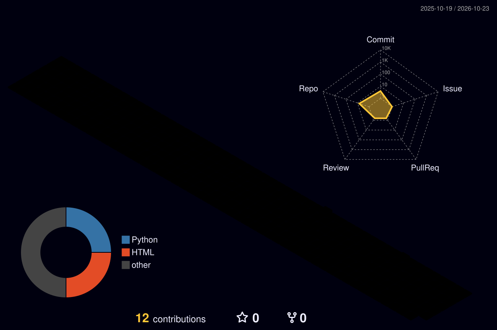

# Hi, I'm Pouya! 👋

## 🚀 About Me

Full-stack developer working across **TypeScript** and **Python**. I build multi-tenant SaaS platforms, AI-powered automation, and privacy-first tools that run locally, encrypt data at rest, and are safe by default. I care about polished, multilingual products with first-class **RTL (Persian/Arabic)** support and solid integrations with local payment and SMS providers.

## 🛠️ Featured Project

### 🧹 [TeleSweep](https://github.com/pouyamoradzad/telesweep)
Audits every Telegram dialog, scores it with a strict rules engine, and cleans out dead chats. It runs 100% locally, does a dry run by default, encrypts credentials with AES-256-GCM, and supports 10 languages with full RTL.
**Stack:** Python · Telethon · FastAPI · Textual · [Landing page →](https://pouyamoradzad.github.io/telesweep/)

## 💻 Tech Stack

### Frontend & UI

### Backend & Data

### AI & Automation

### DevOps & Tools

### Creative

## 📊 GitHub Stats

  
  

## 💡 Philosophy

Good software should earn trust: it keeps your data on your machine, shows you exactly what it will do before it does it, and works just as well in Persian as it does in English. I like turning messy real-world problems into clean, reliable products, and I'm always learning something new along the way.

Let's build something great together! 🚀
